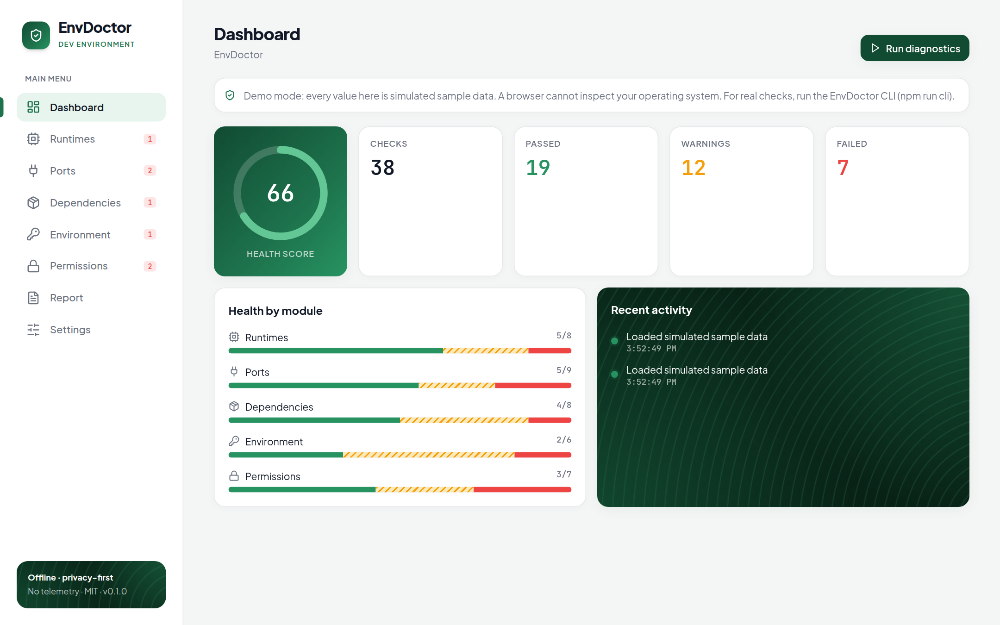
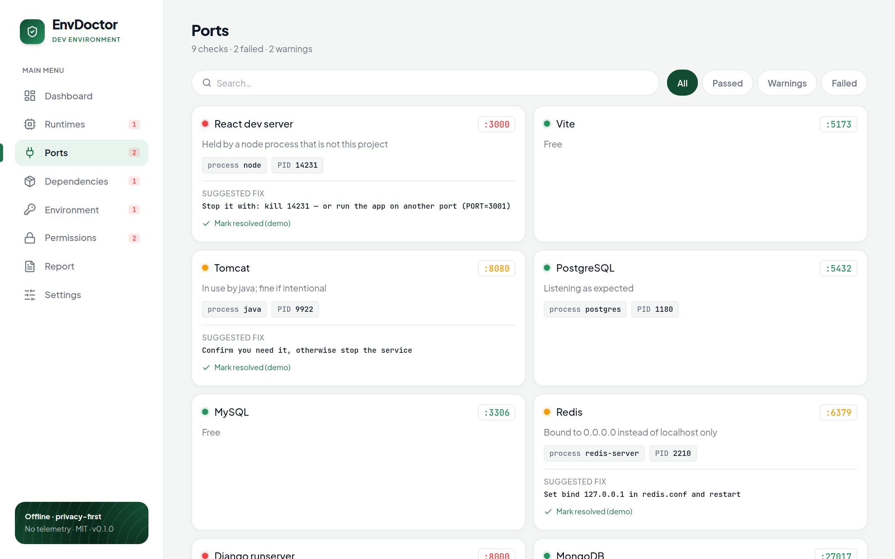
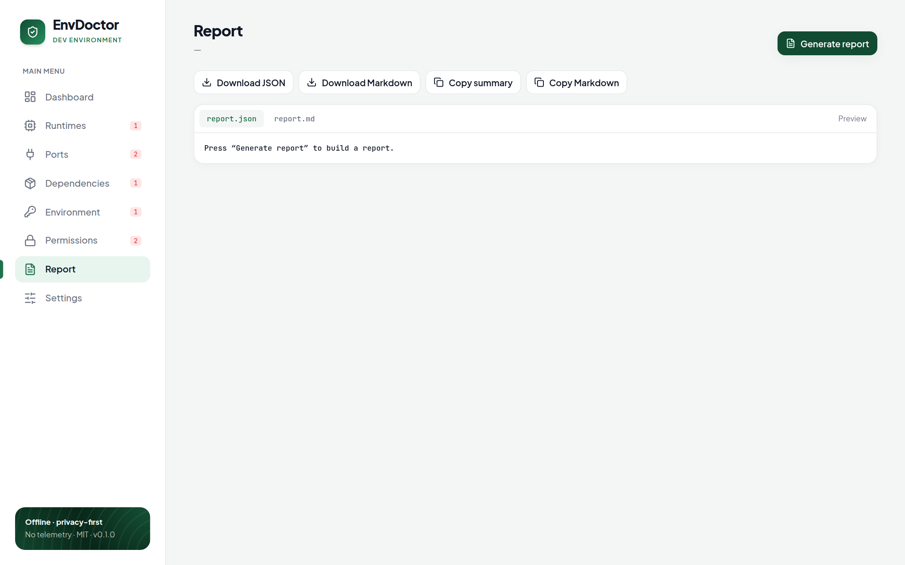
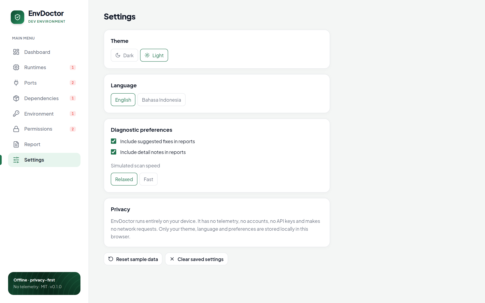

# 🩺 EnvDoctor

**A free, open-source, offline-first, privacy-first doctor for your development environment.**

EnvDoctor helps you diagnose and troubleshoot your local setup: runtimes, ports, dependencies, environment variables and file permissions. No API keys, no accounts, no telemetry, no AI services, no network requests.

> 🇮🇩 Versi Bahasa Indonesia: [README.id.md](README.id.md)

## What is real and what is a demo?

EnvDoctor ships two parts. Please read this so expectations are clear:

| Part | What it does | Data |
|---|---|---|
| **CLI** (`cli/envdoctor.mjs`) | Runs **real**, read-only checks on your machine | Your actual system |
| **Web UI** (`src/`) | Interactive dashboard, filters, reports, themes, i18n | **Simulated sample data** — a browser cannot inspect your OS |

A future **Tauri + Rust** desktop app will feed real diagnostics into the same web UI through the `DiagnosticProvider` interface (see [Architecture](#architecture) and [Roadmap](#roadmap)).

## Features

- **Dashboard** — health score, total/passed/warning/failed checks, health by module, recent activity, simulated scan.
- **Runtime inspector** — Node.js, npm, Python, pip, Java, PHP, Git, Docker.
- **Port conflict inspector** — common dev ports, status, conflicting process, PID, suggested resolution, search and filters.
- **Dependency inspector** — versions, outdated and duplicate examples, health status.
- **Environment variable inspector** — values are always masked; warns about weak or risky configuration.
- **Permission checker** — folder permissions, read/write access, missing directories, `.env` vs `.gitignore`.
- **Reports** — generate, preview, export as **JSON** or **Markdown**, copy a summary to the clipboard.
- **Settings** — light/dark theme, English and Indonesian, report preferences, privacy information, reset sample data.
- **Offline fonts and assets** — everything is bundled locally; nothing is loaded from a CDN.

## Screenshots

| Dashboard | Port inspector |
|---|---|
|  |  |

| Report | Settings |
|---|---|
|  |  |

All screenshots show the demo web UI, which runs on simulated sample data.

## Installation

Requirements: **Node.js 18+** and npm.

```bash
git clone https://github.com/FIQTOR/envdoctor.git
cd envdoctor
npm install
```

## Usage

### Web UI (demo, simulated data)

```bash
npm run dev      # http://localhost:5173
npm run build    # production build in dist/
npm run preview  # serve the production build
```

### CLI (real local checks)

```bash
npm run cli                 # human-readable report for the current directory
node cli/envdoctor.mjs --json > report.json
node cli/envdoctor.mjs --md  > report.md
```

Once published to npm you will be able to run `npx envdoctor` from any project root. The CLI exits with code `1` when any check fails, so it can gate CI.
It never prints environment variable values (only names and lengths), makes no network requests, and does not check outdated/duplicate packages because that requires a registry lookup.

### Tests

```bash
npm test           # Vitest: scoring, report export, i18n completeness
npm run typecheck  # TypeScript
```

## Architecture

```
src/
├─ types.ts               shared data models (Check, Summary, Report, Settings…)
├─ data/sample.ts         fictional demonstration data
├─ diagnostics/
│  ├─ score.ts            health-score logic
│  └─ providers.ts        DiagnosticProvider interface + mock provider
├─ export/
│  ├─ report.ts           build report, JSON, Markdown, summary text
│  └─ browser.ts          clipboard + file download helpers
├─ i18n/                  en.ts (source of truth), id.ts (type-checked), translate()
├─ settings/settings.ts   theme/language/preferences in localStorage
├─ components/            Sidebar, Toast, shared UI primitives, icons
├─ views/                 Dashboard, ListView (all inspectors), ReportView, SettingsView
└─ App.tsx                state, navigation, simulated scan
cli/envdoctor.mjs         zero-dependency real diagnostics
```

**Provider boundary.** The UI never reads system state directly; it asks a `DiagnosticProvider` for `Check[]`. Today that is `mockProvider`. A native build adds a provider whose `collect()` calls a Rust command through Tauri's `invoke`, and the rest of the UI stays unchanged.

**Privacy by design.** No telemetry, accounts, API keys or network requests. Only theme, language and preferences are stored locally.

## Roadmap

- [ ] Publish the CLI to npm (`npx envdoctor`)
- [ ] Feed CLI results into the web UI (import a `--json` report)
- [ ] Tauri + Rust desktop app with a native `DiagnosticProvider`
- [ ] Windows port-owner lookup in the CLI
- [ ] Offline duplicate-dependency detection from lockfiles
- [ ] More inspectors (disk space, shell config, Git hooks) and more languages

## Contributing

Contributions are welcome! Read [CONTRIBUTING.md](CONTRIBUTING.md) and the [Code of Conduct](CODE_OF_CONDUCT.md). Report vulnerabilities privately as described in [SECURITY.md](SECURITY.md). See [CHANGELOG.md](CHANGELOG.md) for releases.

## License

[MIT](LICENSE) © 2026 EnvDoctor contributors
